# Vulnex

Open-source workspace for penetration testing: scope, recon, findings, peer review,
reports, and retest tracking in one Django application.

[](LICENSE)
[](https://github.com/jawad-salem/Vulnex/actions/workflows/test.yml)

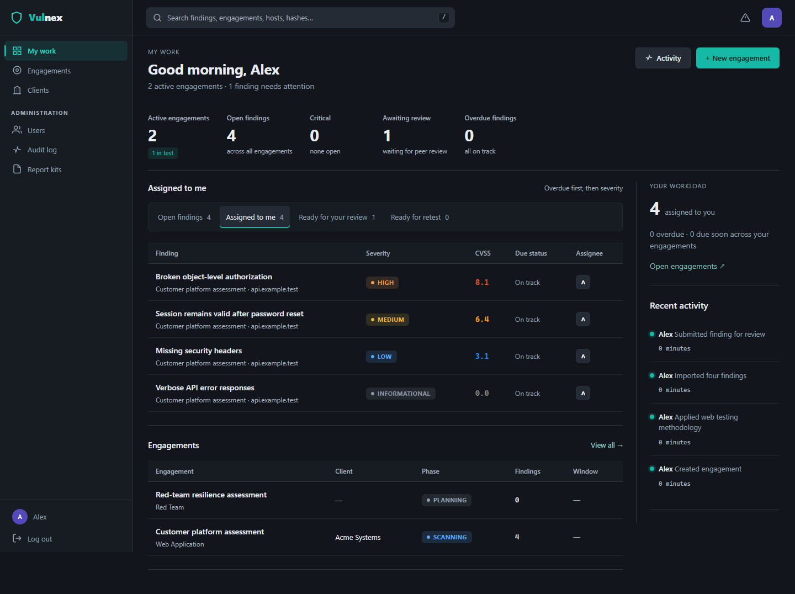

## What it does

- **Organize engagements:** clients, members, scope, external authorization references,
  internal scope confirmation, and methodology checklists.
- **Capture findings:** CVSS v3.1, affected assets, Markdown narratives, evidence,
  discussion, peer review, remediation deadlines, and retest results.
- **Import scanner output:** Nuclei, Nikto, Burp, Nessus, ZAP, Semgrep, and CSV findings
  with deduplication; Nmap XML imports discovered hosts and services.
- **Run scoped recon:** individual scans, pipelines, and schedules with execution-time
  scope validation and exclusions.
- **Document red-team paths:** manually connect entry points, hosts, identities,
  assets, and objectives with techniques and supporting findings.
- **Deliver reports:** generate PDFs, review them internally, then explicitly publish
  individual artifacts for client access.
- **Protect sensitive work:** TOTP and backup codes, login lockout, engagement-level
  permissions, encrypted credential storage, authenticated evidence/report downloads,
  and security-event audit logging.
- **Automate workflows:** REST API, OpenAPI documentation, per-user API keys, and
  MFA-aware JWT authentication.

## Why I built this

I kept ending up in the same gap on engagements: scanner output lived in CSVs, reporting lived in a Word template, methodology coverage lived in a spreadsheet, and credentials lived in `secrets.txt`. The "real" tools were either commercial-tier expensive (PlexTrac, Faraday Pro), or single-purpose (Dradis for reports, DefectDojo for tracking). Vulnex is what I wanted on my own engagements — one workspace where the whole loop lives, with security defaults that don't embarrass a pentester running it.

## Quick start: local demo

```bash
git clone https://github.com/jawad-salem/Vulnex.git
cd Vulnex
cp .env.demo.example .env
docker compose up --build
```

Open <http://localhost:8000> once the web service is ready. The demo configuration
opts into sample engagements, findings, evidence, recon hosts, an attack path,
and a report. It also creates the following accounts:

| Username | Password | Role |
| --- | --- | --- |
| `admin` | `admin1` | Bootstrap superuser |
| `demo-admin` | `demo-password` | Platform admin |
| `demo-pentester` | `demo-password` | Engagement lead / pentester |
| `demo-reviewer` | `demo-password` | Reviewer |
| `demo-client` | `demo-password` | Client |

Admins, pentesters, and reviewers must enroll an authenticator when prompted.
Save the single-use backup codes. Clients may enable MFA voluntarily.

**These are public demo credentials and development settings.** Keep this demo
local. For a clean installation, set `SEED_DEMO=0`, clear
`DJANGO_BOOTSTRAP_PASSWORD`, and replace the example secrets before the first boot.
Create your own administrator with:

```bash
docker compose exec web python manage.py createsuperuser
```

Compose binds to localhost by default. Its configuration is a starting point for
local use; configure HTTPS, database credentials, backups, upload limits, and
proxy trust before deploying it.

## UI tour

Screenshots below were captured from the current application on November 3, 2026
at 1440px width. All records, accounts, hosts, and evidence are synthetic.

### Engagement workspace

An overview of next actions, finding distribution, testing progress, and activity.
Workspace navigation keeps scope, assets, testing, findings, reports, and vault
within reach; red-team engagements also expose attack paths.

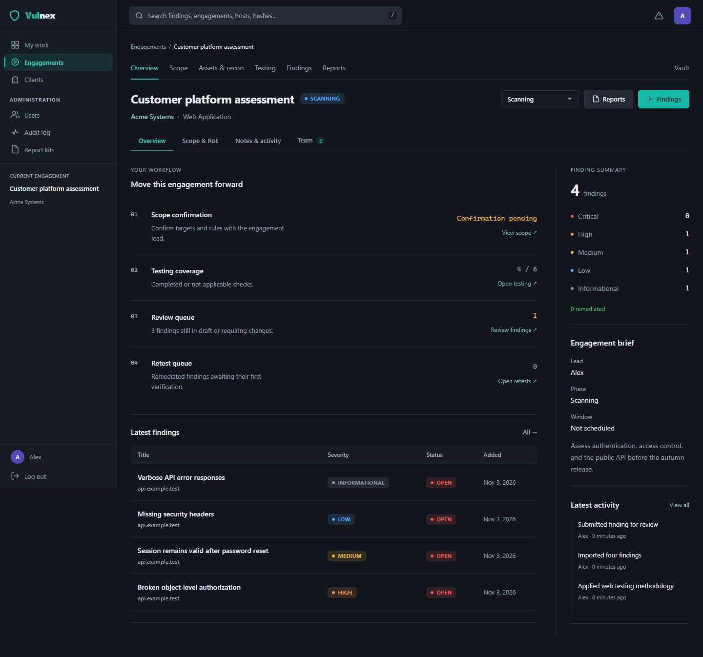

### Findings and review

Queues separate assigned work, review, and retesting. Finding detail combines a
readable narrative with evidence, review controls, affected assets, and retest data.

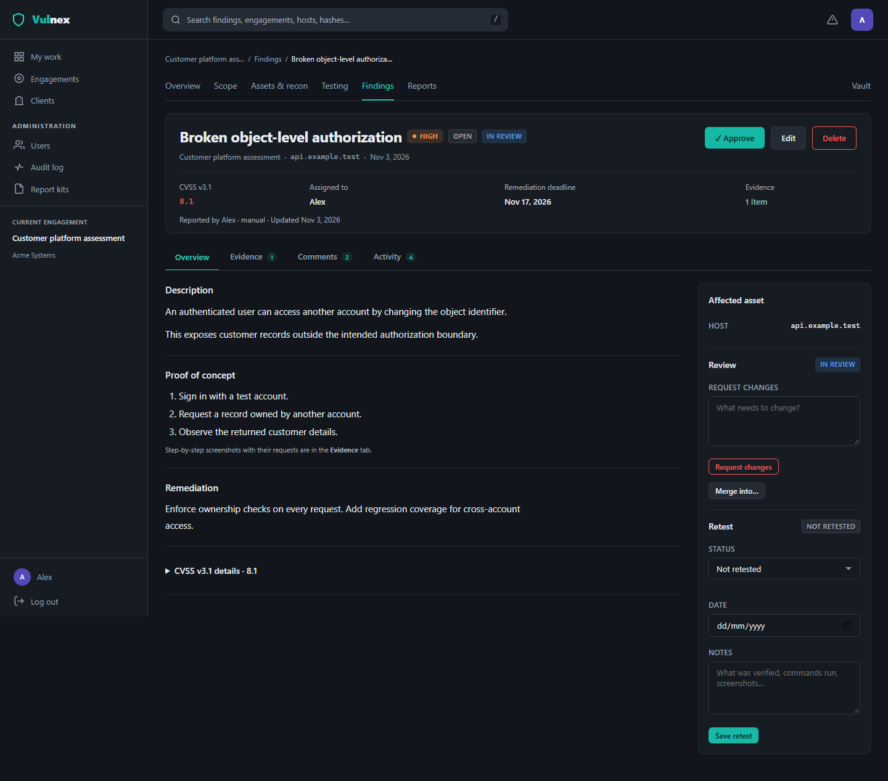

<details>
<summary>View scope, recon, testing, and finding-list screenshots</summary>

#### Scope and rules of engagement

Client authorization stays in the external document process. An internal lead
records its reference and confirms scope; this locks editing and enables eligible
scans. It is not an electronic client signature.

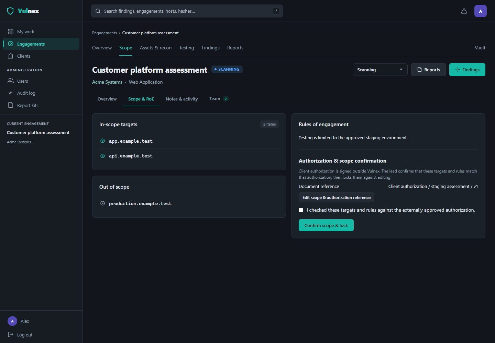

#### Assets and recon

Discover hosts and services, launch supported scans, build pipelines, schedule
jobs, or import Nmap XML. See [scanner scope rules and limits](docs/SCAN_SCOPE.md).

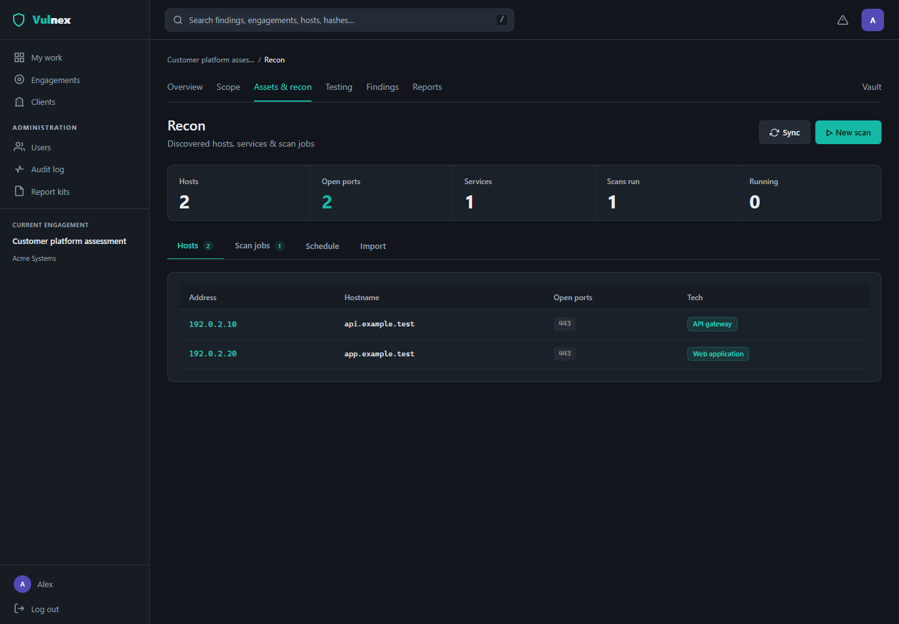

#### Testing coverage

Apply methodology checklists and record testing status. Seed data includes OWASP
WSTG checklists; completion counts describe recorded work, not an assurance rating.

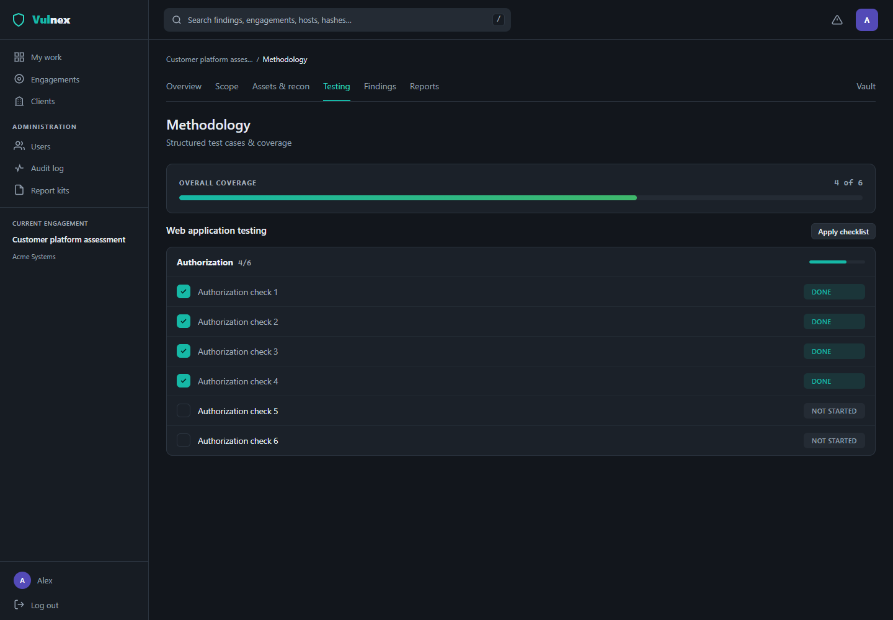

#### Finding queues

Filter by severity, status, assignment, review state, and retest status.

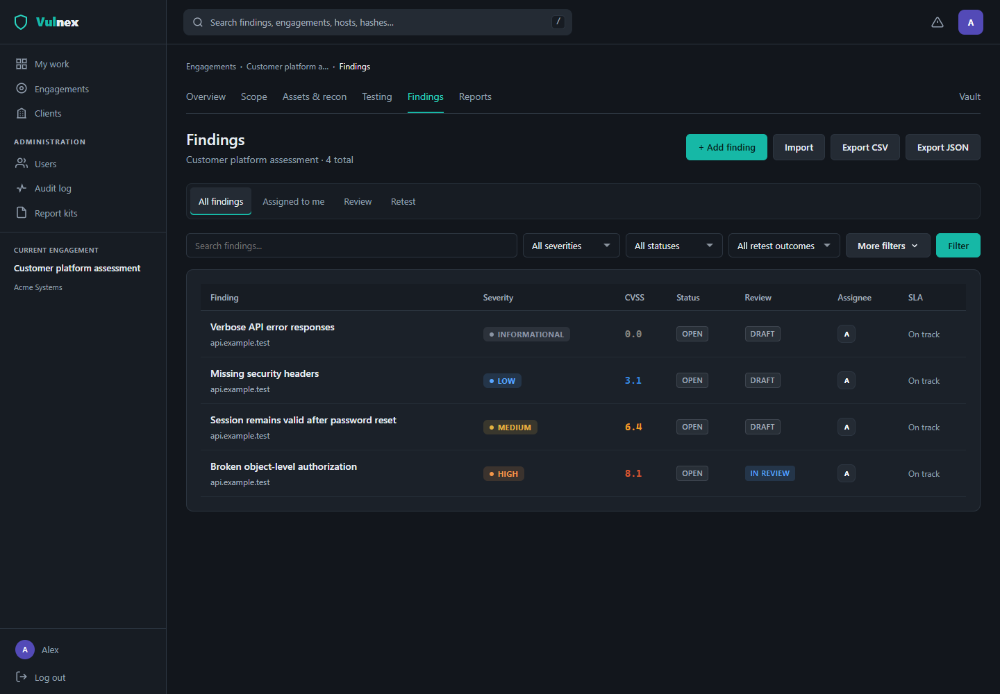

</details>

<details>
<summary>View evidence, comments, vault, attack paths, reports, and audit screenshots</summary>

#### Evidence and discussion

Attach supporting files and request/response text, mark evidence reviewed, and
leave Markdown comments with internal-only and review-feedback flags.

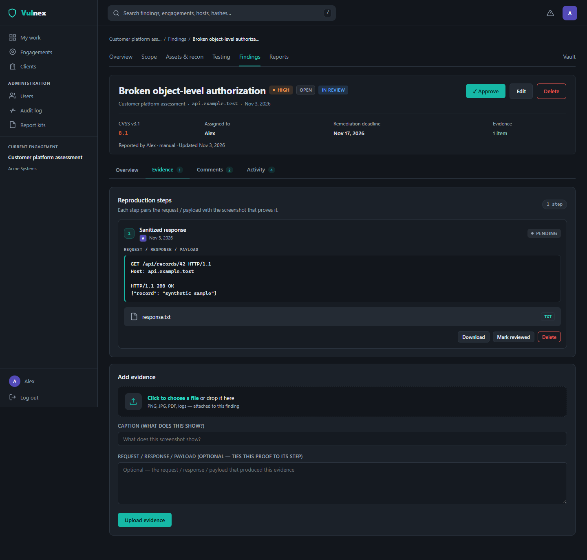

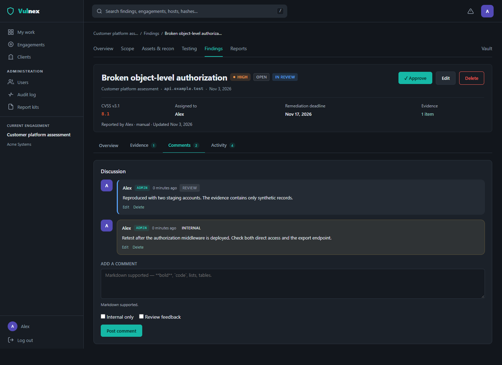

#### Credential vault

Secrets use Fernet encryption with a dedicated vault key. Reveals are explicit
and audited; client-role members cannot access the vault.

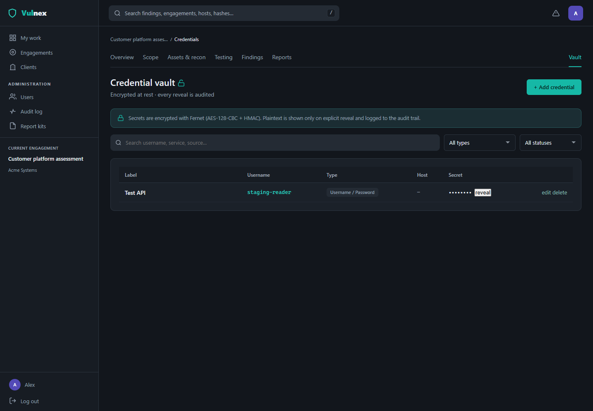

#### Red-team attack paths

Draw the observed path and link supporting findings, with optional MITRE ATT&CK
identifiers. Graph connectivity does not mean an objective was achieved.

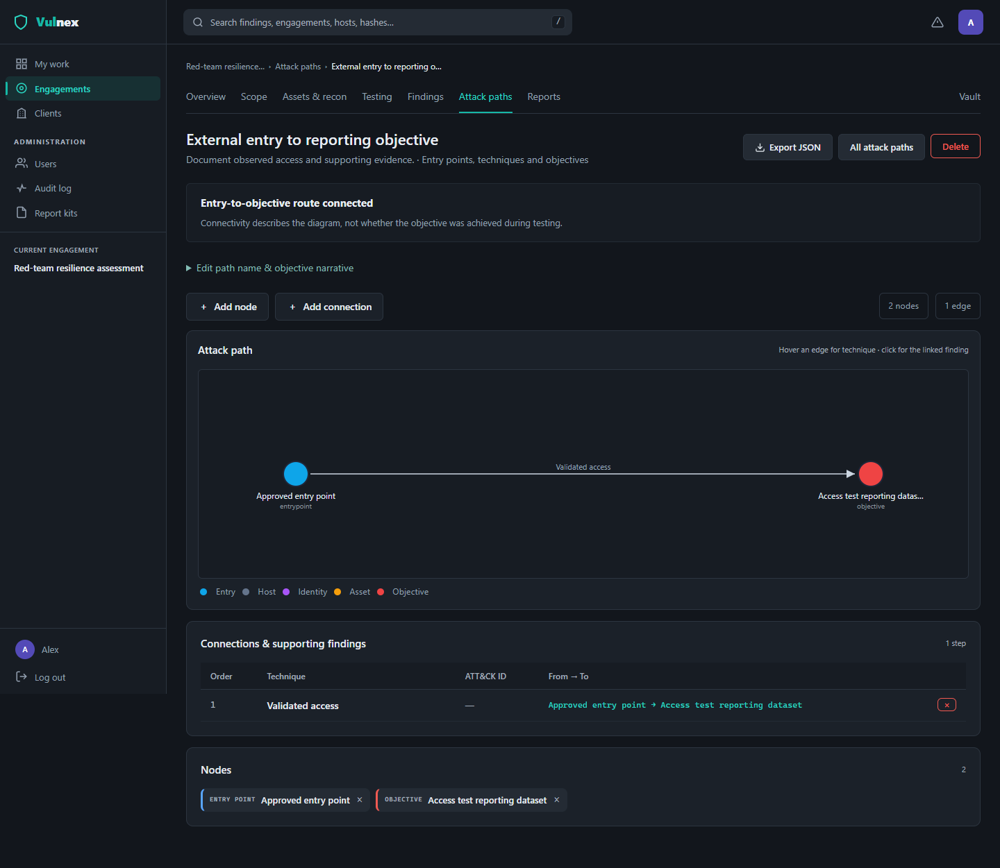

#### Reports

Generate technical or executive PDFs. Reports remain internal until a lead/admin
reviews and publishes the individual artifact. Withdrawal blocks future client
access; it cannot recall downloaded files.

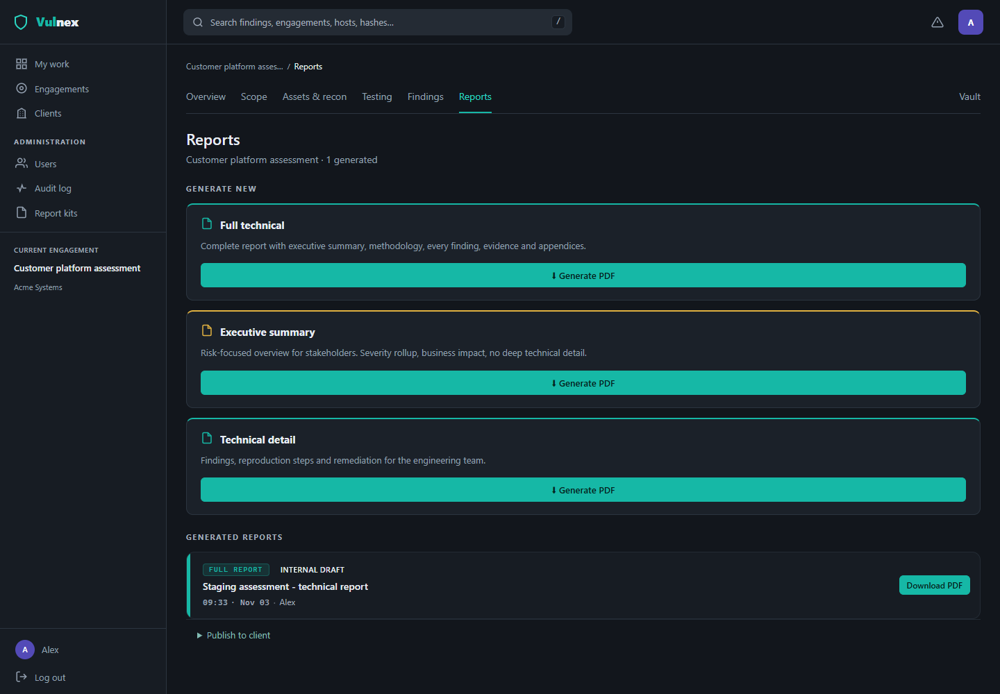

#### Audit trail

Review recorded authentication, MFA, evidence, credential, and reporting events;
export them as CSV. This is application-level logging, not tamper-proof storage.

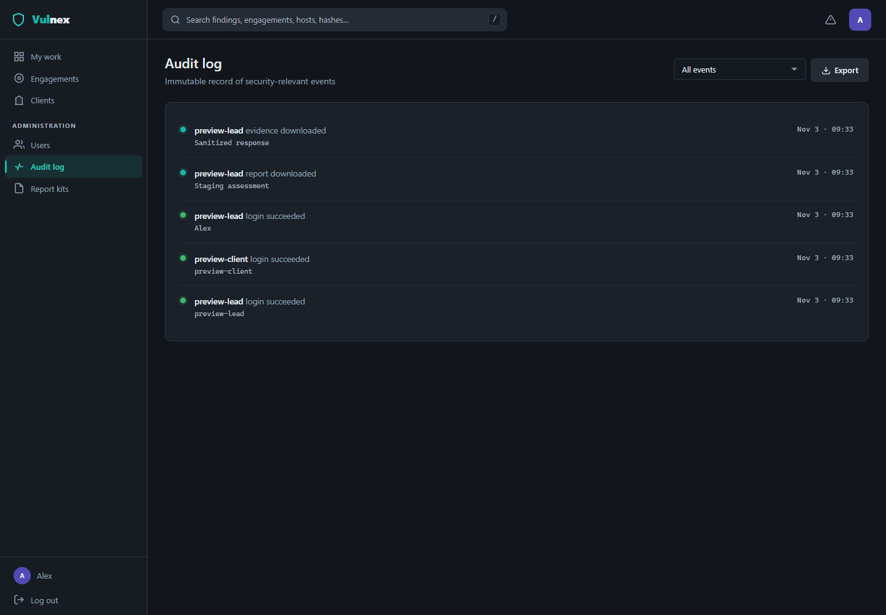

</details>

## Local development

Use Python 3.12 or 3.14, the versions exercised in CI. Docker uses Python 3.12.

```bash
python -m venv .venv
# Linux/macOS:
source .venv/bin/activate
# Windows PowerShell instead:
# .\.venv\Scripts\Activate.ps1

pip install -r requirements.txt -c requirements.lock
cp .env.demo.example .env
# Set local secrets and choose demo or clean-install settings.
python manage.py migrate
python manage.py seed_templates
python manage.py seed_methodologies
python manage.py createsuperuser
python manage.py runserver
```

Optionally run `python manage.py seed_demo` to add sample records and demo accounts.
`SEED_DEMO` controls the Docker entrypoint; native setups seed only when you run the
command. Native development uses SQLite unless `DATABASE_URL` is set. Without a
Celery broker, tasks run eagerly; use Redis and Celery workers for background jobs.

### Configuration

| Variable | Purpose |
| --- | --- |
| `DJANGO_SECRET_KEY` | Required; use a unique generated secret. |
| `DJANGO_DEBUG` | Defaults to false; the demo example enables it. |
| `DJANGO_ALLOWED_HOSTS` | Comma-separated hostnames; defaults to localhost/127.0.0.1. |
| `DJANGO_USE_HTTPS` | Enables secure cookies, redirects, and HSTS; configure your trusted proxy correctly. |
| `DATABASE_URL` | Database connection; Compose supplies PostgreSQL. |
| `VAULT_MASTER_KEY` | Dedicated Fernet key, required outside debug mode. Preserve it with encrypted-data backups. |
| `SITE_URL` | Public base URL used in invitation links. |
| `CELERY_BROKER_URL` | Redis broker for asynchronous scans and schedules. |
| `SEED_DEMO` | Docker demo seeding; use `0` for a clean install. |
| `DJANGO_BOOTSTRAP_PASSWORD` | Docker administrator bootstrap; leave blank to create an account manually. |

See [.env.demo.example](.env.demo.example) for the remaining settings, including email.

### Verification and screenshots

```bash
python manage.py test --settings=vulnex.test_settings
python manage.py makemigrations --check --dry-run --settings=vulnex.test_settings
```

Optional real-browser checks and screenshot refresh:

```bash
pip install -r requirements-dev.txt
# Linux/macOS: install the Chromium browser first.
# python -m playwright install chromium
# Windows: the scripts use installed Microsoft Edge.
python scripts/ui_checks.py
python scripts/capture_readme.py
```

These scripts use disposable data and storage, not your project database.
The screenshot script refreshes `docs/screenshots/`; it never runs real scans.

## API and architecture

Django templates and vanilla JavaScript provide the UI. Domain apps cover accounts,
engagements, findings, recon, methodology, reports, and credentials. Docker combines
Gunicorn, PostgreSQL, Redis, and Celery. There is no SPA build step.

API endpoints live under `/api/v1/`; interactive documentation is at `/api/docs/`
and the schema at `/api/schema/`, with access controls. Scripts can use revocable
API keys; the database stores a key hash and identification prefix. JWT login
requires `otp_code` when MFA is enrolled. Password changes invalidate JWTs.

- [API reference](docs/API.md)
- [Architecture](docs/ARCHITECTURE.md)
- [Frontend structure](docs/FRONTEND.md)
- [Security review and remaining limits](docs/SECURITY_REVIEW.md)

## Limits and next steps

- One deployment has no organization-level tenant boundary above engagement membership.
- Built-in scans accept individual hostnames/IPv4 addresses. URL/path/port-limited,
  IPv6, and batch CIDR scans are unsupported. Private-IP restrictions remain;
  changing scope does not cancel an already-running probe.
- RoE prose and engagement time windows are not automatically interpreted as scan policy.
- Attack paths document a narrative; they do not provide AD enumeration, C2, or live operations.
- Retest fields describe the latest attempt. Append-only history, evidence-bound review
  revisions, and report provenance/version lineage remain future work.
- External issue sync, notifications, DOCX export, and richer methodology/evidence
  linkage remain planned. See [logic review](docs/LOGIC_REVIEW.md) and
  [refactoring status](docs/REFACTORING.md).

## Updating an installation

Back up the database, vault key, and media directories before upgrading. Install
updated requirements, apply migrations, collect production static files, and restart
web/Celery processes. Run `python manage.py check --deploy` against your deployment
configuration. Development `runserver` with debug enabled normally serves source
static files without `collectstatic`.

Migration `reports.0003` moves reports from `media/reports/` to protected storage.
Stop writers during that migration and retain both media volume mounts. It refuses
conflicting destination files and is intentionally irreversible to avoid exposing
private reports on rollback.

## Contributing

Issues and pull requests are welcome. Report security issues privately rather than
posting exploit details in a public issue.

## License

[MIT](LICENSE).
